<div align="center">

# HowToSayGoodbye

**Production Scripts for a 27-Shot Watercolour AI Short Film**
*We Must Learn to Say Goodbye, and Grow Through It* (我们总要学会告别，并在告别中成长)

[](https://www.python.org/)
[](https://www.blender.org/)
[](https://ffmpeg.org/)
[](#script-map)
[](SECURITY.md)
[](#version-and-provenance)

[English](README.en.md) · [简体中文](README.md) · [Online Report](https://ron567-howtosaygoodbye.ms.show/) · [ModelScope Studio](https://modelscope.cn/studios/Ron567/HowtoSayGoodbye)

</div>

---

> **This repository holds the part of the project that turned "uncontrollable" into verifiable engineering.**
> It is neither the finished film nor a one-click toolkit. It is 148 scripts, 41 per-shot workflow graphs, and the full trail of rejected versions from a real production — curated as the **Demo V1.0** submission.

## Contents

| | |
| --- | --- |
| [Background](#background) · [Pipeline](#pipeline) · [Script Map](#script-map) | [Quick Start](#quick-start) · [Layout](#layout) |
| [Data & Assets](#data-and-assets) · [Security](#security) | [Version and Provenance](#version-and-provenance) · [License](#license) |

## Background

*We Must Learn to Say Goodbye, and Grow Through It* is a **3 min 36 s** watercolour concept short. A red hair ribbon with a small white flower at its tip carries the story across three generations: bought by the grandmother → folded into a small bag at a wedding → placed in a keepsake box with an address note → handed to a daughter in a hospital room → replaced by a pair of plain new ribbons tied into a child's braid on stage. The prop carries the narrative; no dialogue explains it.

| Metric | Value |
| --- | --- |
| Shots / runtime | 27 shots × 8.0 s = **216.0 s** |
| Frames / spec | 5184 frames · 1280×720 · 24 fps · H.264 |
| Narrative | Seven acts, adapted from a ~9.6k-character literary script in seven chapters |
| QC trail | 28 `qc_report.json` files (14 previz / 14 final); all 14 final reports passed |
| Process archive | 6973 files under `progress/`, organised into six categories |
| Late-stage convergence | Shots 17–27: 11 consecutive H3 submissions approved first pass |

## Pipeline

```mermaid
flowchart LR
    A["Literary script<br/>9.6k chars / 7 chapters"] --> B["Storyboard & refs<br/>gen_* / asset ledger"]
    B --> C["3D modelling<br/>Lux3D / build_models_*"]
    C --> D["Blender previz<br/>previs_shot*"]
    D --> E["Frame-by-frame QC<br/>qc_* / contact sheets"]
    E --> F["AI generation<br/>ComfyUI H3 / submit_h3"]
    F --> G["Final QC<br/>verdicts / rework"]
    G --> H["Edit & rough cut<br/>roughcut_v0.4 → v0.9"]
    H --> I["Six-category archive<br/>build_progress"]

    style D fill:#e8eef5,stroke:#334b6b,stroke-width:2px
    style E fill:#fdf0e3,stroke:#c0453b,stroke-width:2px
    style H fill:#e8eef5,stroke:#334b6b,stroke-width:2px
```



**What kept the style from drifting: three separated channels.**

| Channel | Locks down | Must NOT be used for |
| --- | --- | --- |
| Text prompt | Lighting, paint style, paper texture | Large physical displacement |
| Watercolour reference images | Layout, character likeness | Style anchoring (photoreal T-poses stay out) |
| Clay previz video | Motion topology, prop physics chain | Final image quality |

> Most rework was not caused by an uncooperative model — the action simply had not been described clearly *before* submission. Shot 16 ("put the old ribbon into the small bag") went through three versions and shot 17 ("phone held against the hand") through six previz rounds; both were fixed in previz, not by lengthening prompts.

## Script Map

Scripts keep their **original filenames and flat layout** under [`tools/`](tools/); categories are distinguished by filename prefix. For a complete per-file index see [`docs/SCRIPTS_INDEX.md`](docs/SCRIPTS_INDEX.md).

| Category | Count | Prefix / representative | Purpose |
| --- | ---: | --- | --- |
| **Modelling & asset generation** | 65 | `gen_*`, `build_models_shot15plus.py`, `probe_*`, `rig_*`, `lux3d_*`, `comfy_ref_gen.py` | Watercolour refs and T-poses, Lux3D modelling / rigging / retargeting, bone probes, GLB inspection |
| **Blender previz** | 45 | `previs_shot*.py`, `blender_render.py`, `pack_previs*.py`, `make_previs09.py` | Per-shot camera blocking, action chains, four-view renders, frame packing |
| **Editing & rough cut** | 7 | `roughcut_v04.py` → `roughcut_v09.py`, `build_previs_compare.py` | Dissolves, audio bridges, tail freeze, 1:1 previz-vs-final comparison film |
| **QC & archiving** | 14 | `qc_allframes.py`, `qc_final_stats.py`, `anim_qc.py`, `build_progress.py` | Full 192-frame numeric checks, contact sheets, verdicts, six-category index |
| **Generation workflows** | 17 | `make_h3_workflow_*.py`, `submit_h3.py`, `wait_h3.py` | Per-shot prompt / seed / reference mapping, single-submit and polling for ComfyUI |

<details>
<summary><b>Why a flat layout instead of folders per category?</b></summary>

Fifteen `previs_shot*.py` files import `previs_shot14`; `roughcut_v09.py` reuses the dissolve stages of v0.8; modelling scripts share ledgers and helpers. Regrouping them into folders would break those relative imports. We therefore kept the original flat structure and added prefix-based classification plus a generated index — readability and traceability first.

</details>

## Quick Start

### Requirements

| Dependency | Used for | Required |
| --- | --- | --- |
| Python 3.12+ | All scripts | ✅ Yes |
| Pillow / NumPy / imageio | Contact sheets, frame extraction, cropping | ✅ Yes |
| Blender 5.2 (CLI) | `bpy` previz and four-view renders | Blender scripts only |
| FFmpeg / ffprobe | Rough cuts, dissolves, comparison film, numeric probes | Editing / QC only |
| ComfyUI (local `127.0.0.1:8188`) | H3 Ref2VA generation | Generation scripts only |
| Lux3D API credential | Cloud modelling / auto-rig | Modelling scripts only; see [SECURITY.md](SECURITY.md) |

> **Blender version note**: This project was built and verified on **Blender 5.2** (see the environment section of `HANDOFF.md`). The scripts rely on the 5.x layered Action API (`channelbag`, `NlaStrip.use_reverse`, ...). Blender 4.x removed `Action.groups` / `Action.fcurves` and will fail on these scripts — use 5.2 or another 5.x build.

### Example commands

> Run every script **from the project root**. Hard-coded local absolute paths have been replaced with relative ones; `FFMPEG` / `blender` are resolved via `PATH` or your own configuration.

```bash
# 1. Generate a watercolour reference / T-pose
python tools/gen_c14_tpose.py

# 2. Modelling pipeline (resumable; paid tasks are never submitted twice)
python tools/build_models_shot15plus.py --only C06
python tools/build_models_shot15plus.py --resume

# 3. Blender previz (1280x720 / 24 fps / 192 frames)
blender --background --python tools/previs_shot16b.py

# 4. Frame-by-frame QC
python tools/qc_allframes.py

# 5. Rough cut v0.9 (27 shots / 217.5 s / 3.0 s tail freeze)
python tools/roughcut_v09.py

# 6. Per-shot 1:1 previz vs final comparison film
python tools/build_previs_compare.py
```

## Layout

```text
HowToSayGoodbye/
├── README.en.md                  # English (this file)
├── README.md                     # 简体中文
├── SECURITY.md                   # Credential policy and scan results
├── .gitignore                    # Blocks keys, media, caches
├── docs/
│   ├── SCRIPTS_INDEX.md          # Full index of all 148 scripts
│   └── manifest.json             # Counts / categories / sanitisation stats
└── tools/                        # Original flat structure
    ├── gen_*.py                  # Reference and asset generation
    ├── previs_shot*.py           # Blender clay previz
    ├── roughcut_v0*.py           # Successive rough cuts
    ├── qc_*.py                   # Frame-by-frame QC
    ├── h3_r2v_workflow_*.json    # 41 per-shot generation graphs
    ├── contracts/                # Scene delivery contracts
    └── lux3d_runtime/            # Modelling runtime helpers
```

## Data and Assets

| Item | In this repo | Note |
| --- | --- | --- |
| Scripts and workflow graphs | ✅ Included | 148 `.py` + 41 `.json` |
| Character / scene / prop references | ❌ Excluded | Original `assets/` ≈ 7.3 GB |
| Final and previz videos | ❌ Excluded | Final 552 MB, previz 45.9 MB |
| Full process archive | ❌ Excluded | `progress/` ≈ 4.5 GB / 6973 files |
| Curated evidence | 🔗 Available online | 107 files under `evidence/`, 198 clickable citations in the Studio |

Workflow JSON files record each shot's prompt, seed, model and reference **filenames** — enough to audit parameters, without shipping the media itself. For the complete evidence chain, see Appendix A.4 of the [online report](https://ron567-howtosaygoodbye.ms.show/).

## Security

**This repository contains no plaintext credentials.** Eight repository-wide scans were run during assembly; all returned zero hits:

| Check | Result |
| --- | --- |
| `sk-` / `ms-` style keys, hard-coded Bearer tokens, credential assignments, plaintext `oauth2:` | 0 |
| Email addresses, phone numbers | 0 |
| Local absolute paths (Windows drive-letter form) | 0 (**41** occurrences sanitised) |

- Credentials are injected only via **environment variables or the local OS credential store**; no values appear in code. See [SECURITY.md](SECURITY.md).
- **Deliberately excluded**: deployment/sync scripts (build tokenised URLs), the third-party `aholo-lux3d-ref/` bundle (sample keys and its own licence), document-generation tools, caches and binary media.
- `.gitignore` additionally blocks `.env`, `*.key`, `*.pem`, credential files and all media directories.

## Version and Provenance

| Item | Value |
| --- | --- |
| Version | **Demo V1.0** (submitted 2026-11-16) |
| Production report | https://ron567-howtosaygoodbye.ms.show/ |
| ModelScope Studio | https://modelscope.cn/studios/Ron567/HowtoSayGoodbye |
| Archive baseline | 2026-11-15 |
| Data sources | `HANDOFF.md`, `progress/README.md`, rough-cut timelines v0.7 / v0.9, 28 `qc_report.json` files |

These scripts are **process records, not a general-purpose library**. Some were written for one-off batch runs and contain specific shot numbers and project-relative paths; adapting them to another project requires adjustment. That is intentional — it is precisely the evidence of *how* the film was made.

## License

This repository exists for process documentation and review. **No open-source licence is granted** (all rights reserved by default). Please contact the author before reuse or redistribution.

---

<div align="center">

<sub>Built from a 9.6k-word essay, 27 shots, and every rejected version we kept.</sub>

</div>
